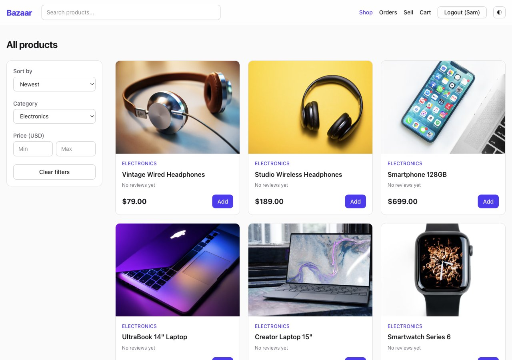
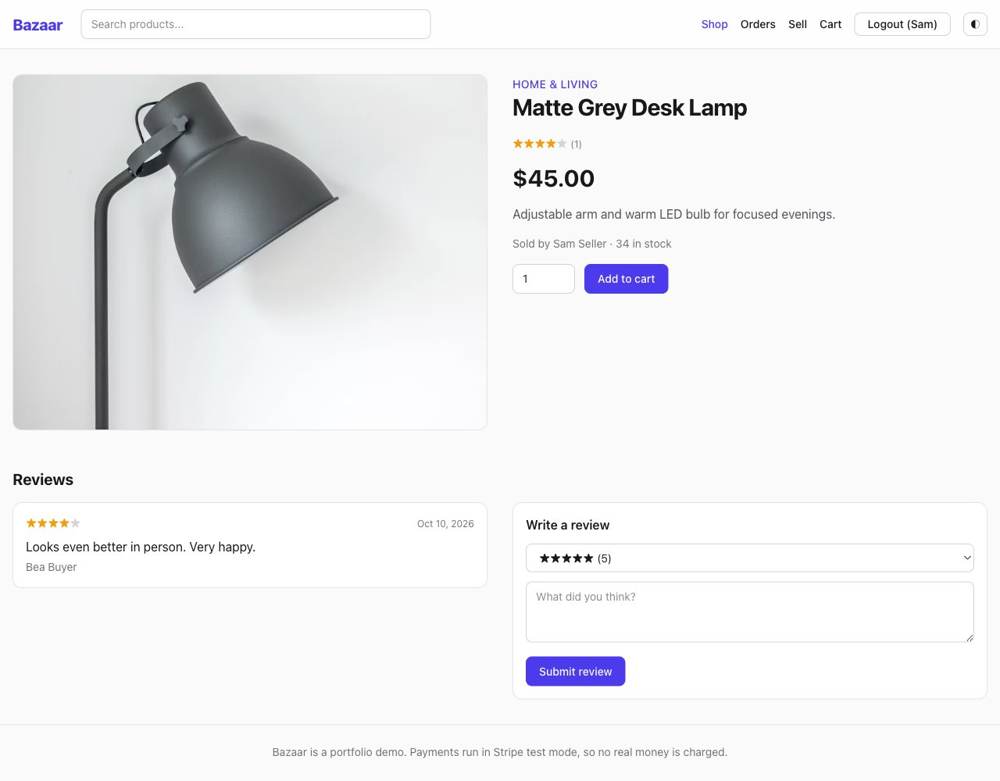
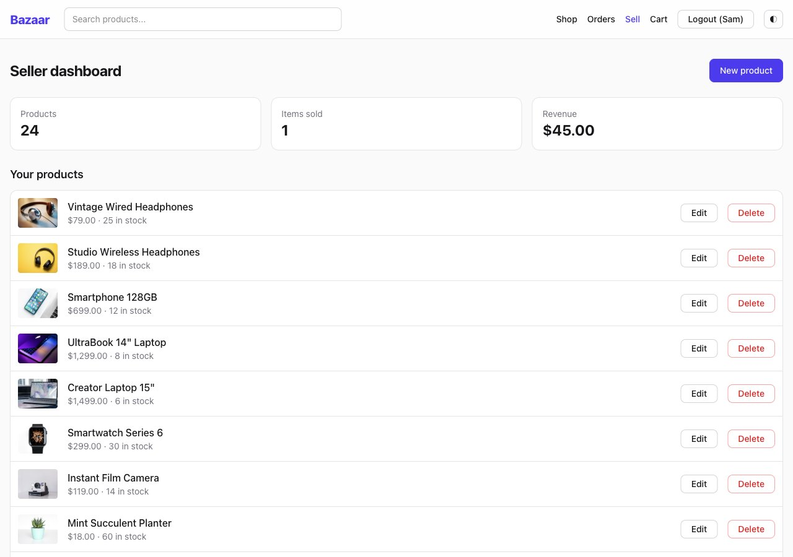
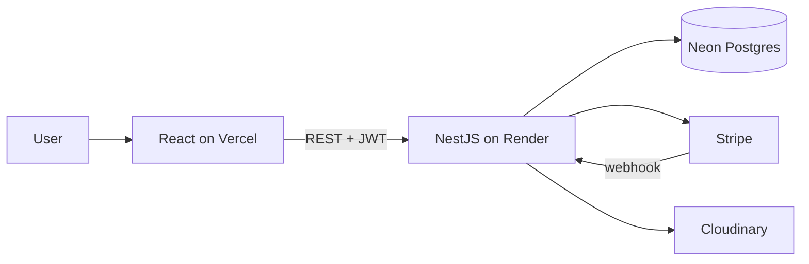

# Bazaar - Full-Stack Online Marketplace

A production-style marketplace where buyers browse and purchase products, sellers manage their own catalog, and admins moderate the platform. Built with **React**, **NestJS**, **PostgreSQL** and **Stripe**.

| | |
|---|---|
| Live demo | https://bazaar-marketplace-tan.vercel.app |
| API docs (Swagger) | https://bazaar-api-l828.onrender.com/docs |


<table>
  <tr>
    <td></td>
    <td></td>
  </tr>
  <tr>
    <td colspan="2"></td>
  </tr>
</table>

## Features

- **Auth & roles:** register/login with JWT access + refresh tokens, three roles (buyer, seller, admin), role-guarded routes on both API and UI
- **Catalog:** full-text search, category filter, price range, sorting and pagination, all driven by URL query params
- **Cart & checkout:** persistent cart, server-side price/stock validation, **Stripe Checkout** (test mode) with webhook and a fallback confirmation so orders are never stuck unpaid
- **Orders:** order history and idempotent `PENDING -> PAID` transition that decrements stock in a transaction
- **Seller dashboard:** create / edit / delete products, Cloudinary image upload, revenue and sales overview
- **Admin panel:** manage users and products
- **Reviews & ratings:** one review per user per product, aggregated ratings
- **Polish:** responsive layout, dark mode, loading and error states, accessible labels

## Tech stack

| Layer | Tools |
|---|---|
| Frontend | React 19, Vite, TypeScript, Tailwind CSS 4, React Router, TanStack Query, Zustand |
| Backend | NestJS, TypeScript, Prisma 7 (PostgreSQL), class-validator, Swagger/OpenAPI, Helmet, rate limiting |
| Payments | Stripe Checkout + webhooks (test mode) |
| Images | Cloudinary |
| Quality | Vitest unit + e2e tests, oxlint, GitHub Actions CI |
| Hosting | Vercel (web), Render (API), Neon (Postgres) |

## Architecture



```
apps/
  api/   NestJS API (auth, products, orders, uploads, users) + Prisma schema and seed
  web/   React SPA
```

Notable design decisions:

- Prices are stored as integer cents; the server recomputes totals from the database and never trusts client prices.
- `markPaid` is idempotent (`updateMany ... where status = PENDING`), so webhook retries and the "confirm on read" fallback cannot double-decrement stock.
- Without Stripe keys the API marks orders paid immediately, which keeps local development and e2e tests frictionless.
- Access tokens live 15 minutes; the web client transparently refreshes once on a `401`.

## Run locally

Requirements: Node 22+, Docker.

```bash
# 1. database
docker compose up -d

# 2. API (http://localhost:3000, Swagger at /docs)
cd apps/api
cp .env.example .env
npm install
npx prisma migrate deploy
npx prisma db seed
npm run start:dev

# 3. Web (http://localhost:5173)
cd ../web
cp .env.example .env
npm install
npm run dev
```

Demo accounts created by the seed:

| Role | Email | Password |
|---|---|---|
| Buyer | buyer@bazaar.dev | Buyer123! |
| Seller | seller@bazaar.dev | Seller123! |
| Admin | admin@bazaar.dev | Admin123! |

Stripe test card: `4242 4242 4242 4242`, any future expiry, any CVC. To enable Stripe locally set `STRIPE_SECRET_KEY` (and `STRIPE_WEBHOOK_SECRET` via `stripe listen --forward-to localhost:3000/orders/webhook`).

## Tests

```bash
cd apps/api
npm test          # unit tests
npm run test:e2e  # end-to-end buy flow against a real Postgres
```

## Deployment

1. **Database:** create a free Neon project and copy the connection string.
2. **API:** create a Render Blueprint from this repo (`render.yaml`) and set `DATABASE_URL`, `WEB_URL` (your Vercel URL) and the optional Stripe / Cloudinary variables. Migrations run automatically on start.
3. **Seed once:** `DATABASE_URL=<neon url> npx prisma db seed` from `apps/api`.
4. **Web:** import the repo into Vercel with root directory `apps/web` and set `VITE_API_URL` to the Render URL.
5. **Stripe:** add a webhook endpoint `https://<api>/orders/webhook` for `checkout.session.completed` and put its signing secret in `STRIPE_WEBHOOK_SECRET`.

> The Render free tier sleeps when idle, so the first request after a pause can take up to a minute.

## License

MIT
